I build LLM systems for places where a wrong answer is expensive: energy, construction, law and procurement. The model proposes; deterministic code and evals decide what ships.

Second-year B.Eng. Civil Engineering at Cardiff University Kazakhstan, Altyn Belgi State Scholar (top 4% nationally). English, Russian, Kazakh.

### Now

- **Building:** Axion (drawings to checked BIM models), piloting with KazTransOil's R&D Centre.
- **Next:** agent roles on Synarch's control kernel.
- **Ask me about:** text-to-SQL that cannot invent numbers, RAG that verifies its own citations.

### Work

- **AI Engineering Intern, [KazMunayGas](https://kmg.kz)** (Jul-Sep 2026). Text-to-SQL platform on the live data warehouse for the Management Board and Board of Directors: the model picks from a hand-written semantic layer and fixed code builds every query. 1,260+ tests, evals across four LLM providers. Also an AI audit platform for IT budgets across a 64-company group.
- **Independent AI and software engineer** (Nov 2025 - now). Production software for energy, construction and healthcare clients. RAG agents and OCR-to-CRM/ERP automation that cut manual document processing 60%.
- **Axion** (founder, sole engineer). 2D drawings to checked BIM models plus a citation-only copilot. Piloting with KazTransOil's R&D Centre.
- **Synarch, formerly KazLex AI.** Legal RAG for the General Prosecutor's Office of Kazakhstan: 3,350+ articles, every citation verified against the source text. Multi-agent control kernel with human approval and a tamper-evident log.
- **R&D intern, KazTransOil** (Jun-Aug 2025). Data baseline from 1,000+ pipeline-network records for the AI-adoption review.

### Open source

| | Project | |
|---|---|---|
|  | [**semantic-layer-dashboard**](https://github.com/AyanbergenSaduakassov07/semantic-layer-dashboard) | Natural-language dashboards where the LLM never writes SQL. Co-authored with Nurdaulet Khaidar. |
|  | [**qazsupply-procurement-os**](https://github.com/AyanbergenSaduakassov07/qazsupply-procurement-os) | Supplier vetting and spend analysis for Kazakhstan. Multi-tenant, Postgres RLS, synthetic data. |
|  | [**Axion-Bim**](https://github.com/AyanbergenSaduakassov07/Axion-Bim) | IFC and IDS checks, quantity deltas and BCF issues for building models. |
|  | [**MeetingOS**](https://github.com/AyanbergenSaduakassov07/MeetingOS) | Meeting notes where every decision is checked against a transcript quote. Built on [Voicebox](https://github.com/jamiepine/voicebox) by Jamie Pine (MIT). |
|  | [**agent-roi-calculator**](https://github.com/AyanbergenSaduakassov07/agent-roi-calculator) | Savings, payback, NPV and IRR for AI-agent budgets. |
|  | [**budget-audit-assistant**](https://github.com/AyanbergenSaduakassov07/budget-audit-assistant) | Chat-first audit of corporate IT-budget workbooks. |
|  | [**volve-hybrid-forecast**](https://github.com/AyanbergenSaduakassov07/volve-hybrid-forecast) | Arps decline curves plus learned residuals on Equinor's open Volve data. |
|  | [**novamed-clinic-site**](https://github.com/AyanbergenSaduakassov07/novamed-clinic-site) | Bilingual (RU/KZ) clinic site with WhatsApp booking. |
|  | [**alabs-studio**](https://github.com/AyanbergenSaduakassov07/alabs-studio) | Portfolio and intake site for an independent engineering studio. |

<picture>
  <source media="(prefers-color-scheme: dark)" srcset="https://raw.githubusercontent.com/AyanbergenSaduakassov07/AyanbergenSaduakassov07/output/snake-dark.svg"/>
  
</picture>

### Stack

**Research:** Lumiere Research Scholar, Pioneer Academics, Algoverse AI Research.
**Contact:** [LinkedIn](https://www.linkedin.com/in/ayanbergensaduakassov) · [ayansaduakassov@gmail.com](mailto:ayansaduakassov@gmail.com)
