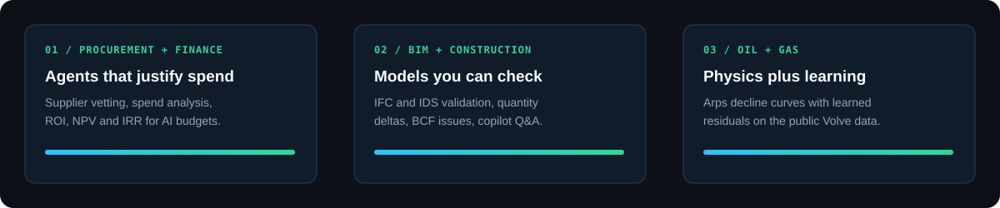

  

  
  
  

## About

Forward-deployed AI engineer and civil engineering student (B.Eng., Cardiff University Kazakhstan; Altyn Belgi State Scholar, top 4% nationally). I build AI systems for domains where a wrong answer costs money: construction, energy, procurement, law.

My working rule: the model proposes, deterministic code and evals decide. That means schema-bound tool calls instead of free-form SQL, citations verified against source text, and regression suites before new features.

## Experience

| When | Role | What I did |
|---|---|---|
| Jul-Sep 2026 | **AI Engineering Intern**, KazMunayGas (KMG), Digitization Department | Built an AI analytics platform on the live data warehouse so the Management Board and Board of Directors can query production, downtime and well data in plain language. The model chooses from a hand-written semantic layer and fixed code builds every query, verified by 1,260+ automated tests and an eval harness across four LLM providers. Also built an AI audit platform for IT-budget workbooks across a 64-company group. |
| Nov 2025 - now | **Independent AI and Software Engineer** | Production software for energy, construction and healthcare clients, from requirements to handover. RAG agents and OCR-to-CRM/ERP automations that cut manual document processing 60% for construction clients. |
| 2026 - now | **Founder and sole engineer, Axion** | Drawings to checked BIM models with a citation-only copilot; piloting with KazTransOil's R&D Centre. |
| 2025 - now | **Synarch (formerly KazLex AI)** | Legal RAG for the General Prosecutor's Office of Kazakhstan: cited answers across 3,350+ articles of law at 87.3% recall@10 on a hand-verified benchmark. Multi-agent control kernel with human approval and a tamper-evident journal. |
| Jun-Aug 2025 | **R&D Intern**, KazTransOil (KTO), Standards and Innovation | Built the data baseline for the AI-adoption review from 1,000+ operational records of the national trunk-pipeline network. |

## Featured projects

  
  

  
  

  
  

  
  

## Stack

  
  
  
  
  
  
  
  
  
  
  
  

**AI:** LLM tool use and agents, RAG with citations, text-to-SQL over a semantic layer, evals and guardrails (Claude and Gemini APIs).
**Data and engineering:** pandas, SQL, Postgres row-level security, pytest, vitest, Jest, ruff, mypy, GitHub Actions.
**ML:** PyTorch, scikit-learn, XGBoost, time-series forecasting, computer vision (OpenCV), Whisper, MLflow.
**Domain:** BIM (IFC, IDS, BCF, IfcOpenShell), structural analysis (PyNite), structural and civil engineering, oil and gas decline analysis (Arps, EUR, P10/P90).

## Research and honours

Lumiere Research Scholar · Pioneer Academics · Algoverse AI Research.

## Activity

  <picture>
    <source media="(prefers-color-scheme: dark)" srcset="https://raw.githubusercontent.com/AyanbergenSaduakassov07/AyanbergenSaduakassov07/output/snake-dark.svg"/>
    
  </picture>

  
  

  

  

## How I work

- Tests and lint run in CI before a README claims anything.
- Prototypes are labelled as prototypes; limitations sit next to features.
- Demo data in public repos is synthetic or public.

